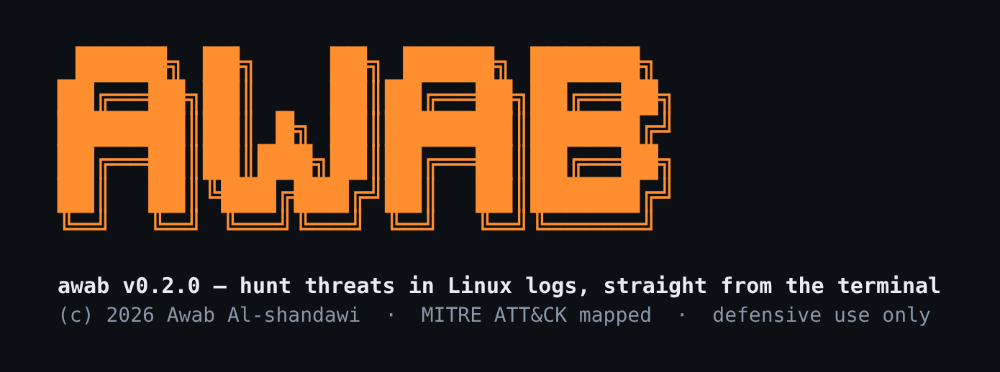

<div align="center">



# awab

**Fast, zero-dependency Linux log triage & threat-hunting engine — mapped to MITRE ATT&CK.**

Point it at a log. Get back a ranked list of what looks like an attack.
No SIEM, no agent, no cloud, no config — just a single static binary.

[](https://github.com/mechanicb0y/awab/actions/workflows/ci.yml)
[](https://github.com/mechanicb0y/awab/releases)
[](#license)


</div>

```console
$ awab scan /var/log/auth.log

awab — Linux log triage

Scanned 20 event(s) with 10 rule(s).
Found 6 finding(s): 1 critical, 2 high, 3 medium, 0 low, 0 info.

┌──────────┬─────────────────────────────────────┬──────────────┬───────┬───────────┐
│ LEVEL    │ RULE                                │ KEY          │ COUNT │ ATT&CK    │
├──────────┼─────────────────────────────────────┼──────────────┼───────┼───────────┤
│ CRITICAL │ New account created with UID 0      │ -            │ 1     │ T1136.001 │
│ HIGH     │ SSH brute-force attempt             │ 203.0.113.5  │ 8     │ T1110.001 │
│ HIGH     │ SSH password spray                  │ 198.51.100.7 │ 6     │ T1110.003 │
│ MEDIUM   │ Interactive shell launched via sudo │ -            │ 1     │ T1548.003 │
│ MEDIUM   │ New user account created            │ -            │ 1     │ T1136.001 │
│ MEDIUM   │ Successful SSH login as root        │ -            │ 1     │ T1021.004 │
└──────────┴─────────────────────────────────────┴──────────────┴───────┴───────────┘
```

---

## Why awab?

Most blue-team tooling assumes you already have a SIEM, a budget, and a network
connection. That leaves out a huge number of people: students, home-labbers,
CTF players, responders working a compromised box over a slow SSH session, and
anyone staring at a raw log dump at 2 a.m.

Windows defenders have a rich ecosystem for this (Hayabusa, Chainsaw, KAPE).
**Linux has mostly been shell scripts.** `awab` is the fast, friendly,
single-binary triage tool for Linux logs.

- **Zero dependencies.** `awab` is built with the Rust standard library and
  *nothing else*. The entire supply chain is this repository. It audits in an
  afternoon and builds offline on a locked-down or air-gapped host.
- **No infrastructure.** It reads a file, a directory, or stdin. That's it.
- **Detections are data, not code.** Every detection is a small YAML rule. Add
  your own in two minutes, or send a PR so everyone benefits (see
  [writing rules](rules/README.md)).
- **MITRE ATT&CK everywhere.** Every finding tells you the tactic and technique,
  so triage flows straight into your existing playbooks.
- **Built for pipes and CI.** Clean `--json`, a standalone `--html` report, and
  an exit code you can gate a cron job on.

## Install

### Prebuilt binary — Linux (recommended)

awab is a Linux tool, so releases ship a static (musl) Linux binary for
**x86_64** and **ARM64** — no glibc worries, runs on any Linux:

```sh
curl -fsSL https://raw.githubusercontent.com/mechanicb0y/awab/main/install.sh | sh
```

Or grab the `.tar.gz` from the [releases page](https://github.com/mechanicb0y/awab/releases) and drop the binary on your `$PATH`.

### From source (any OS with Rust)

Requires a recent Rust toolchain ([rustup](https://rustup.rs)):

```sh
cargo install --git https://github.com/mechanicb0y/awab awab-cli
# or, in a clone:
cargo build --release    # binary at target/release/awab
```

Because there are no dependencies, this builds with no network access once the
toolchain is installed — on Linux, macOS, or Windows.

## Usage

```sh
# Triage an auth log
awab scan /var/log/auth.log

# Scan a whole directory of logs
awab scan /var/log

# Pipe live journal output straight in (what to use on Kali / systemd distros)
journalctl -o short-iso | awab scan -

# Scan the audit log (auditd)
awab scan /var/log/audit/audit.log

# Machine-readable output for another tool / SIEM
awab scan /var/log/auth.log --format json > findings.json

# A shareable, self-contained HTML report
awab scan /var/log/auth.log --html report.html

# Only show the serious stuff (output groups by rule; -a/--full shows every hit)
awab scan /var/log --min-level high
```

> **On Kali / modern systemd distros** there's often no `/var/log/auth.log` —
> logs live in the journal. Use `journalctl -o short-iso | awab scan -`. awab
> will remind you of this if you point it at a missing log file.

Exit codes: `0` = nothing high or above, `1` = high/critical findings, `2` =
error. That makes `awab` a one-line tripwire in a cron job:

```sh
awab scan /var/log/auth.log --min-level high >/dev/null || notify-admin
```

## What it detects today

awab ships detections for the most common Linux attack signatures:

| Area | Examples |
|------|----------|
| **SSH** | brute force, password spray, direct root login |
| **Privilege escalation** | interactive shell via sudo, repeated sudo auth failures, **SUID/SGID bit set** |
| **Persistence** | new user accounts, **UID-0 / root-group / root-home backdoor accounts**, **cron & systemd persistence** |
| **Defense evasion** | **system log wiping**, **shell history tampering** |
| **Web** | web-shell access, path-traversal / injection probes |
| **Execution** | reverse-shell command patterns |

Run `awab rules list` to see everything loaded. The set grows with every
contributed rule.

## How it works

```
 logs ──▶ parser ──▶ normalized events ──▶ rule engine ──▶ findings
          (syslog,     (timestamp, user,     (match +        (ranked,
           web, …)      source_ip, …)         correlate)       ATT&CK-tagged)
```

1. **Parsers** normalize messy log formats (`auth.log`/syslog, journald, web
   access logs, and **auditd** `audit.log`) into structured events with fields
   like `source_ip`, `user`, `command`, and `event_type`.
2. **Rules** — small YAML files — match those events. They can match single
   events or **correlate bursts** (e.g. "5+ failures from one IP within 60s").
3. **Findings** come out ranked by severity, each tagged with its MITRE ATT&CK
   technique and the raw log lines that triggered it.

## Writing a rule (the 2-minute version)

Detections live in [`rules/`](rules/). A rule is just YAML:

```yaml
id: awab-ssh-bruteforce
title: SSH brute-force attempt
level: high
mitre:
  tactic: credential-access
  technique: T1110.001
logsource:
  service: sshd
detection:
  selection:
    event_type: auth_failure
  group_by: source_ip     # correlate per source IP
  timewindow: 60s         # within a sliding 60-second window
  threshold: 5            # fire at 5+ matches
```

Validate it and run it:

```sh
awab rules validate ./my-rules
awab scan /var/log/auth.log --rules ./my-rules
```

Full field reference and operators (`contains`, `regex`, `startswith`,
`count_distinct`, …) are in **[rules/README.md](rules/README.md)**. New rules are
the single most valuable contribution you can make — see
[CONTRIBUTING.md](CONTRIBUTING.md).

## Roadmap

- More parsers: journald JSON, `audit.log` (auditd), nftables/ufw
- Multi-stage attack-chain correlation (link recon → access → persistence)
- A live community rule feed for `awab update`
- Distro packages (`.deb`, AUR, Homebrew, and a Kali metapackage)

## Contributing

Issues and PRs are very welcome — especially new detection rules. Start with
the [good first issues](https://github.com/mechanicb0y/awab/labels/good%20first%20issue)
and read [CONTRIBUTING.md](CONTRIBUTING.md).

## License

Licensed under either of [MIT](LICENSE-MIT) or [Apache-2.0](LICENSE-APACHE) at
your option.

---

<div align="center">
Built by <b>Awab Al-shandawi</b>. If awab saves you a late night, consider leaving a ⭐.
</div>
